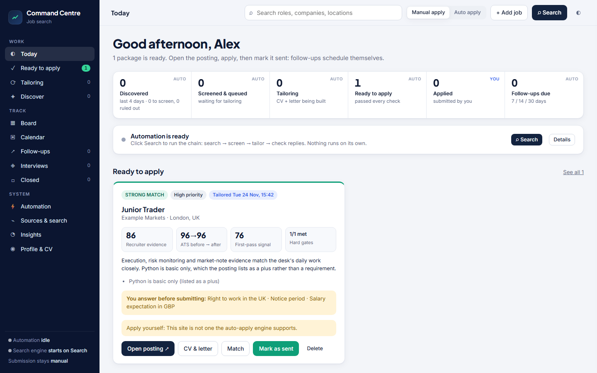

# Job Search Command Centre

A local, AI-assisted job application engine. It finds roles, screens each one against a recruiter and ATS
framework, and tailors a CV and cover letter **only from facts in a locked master CV**, then tracks every
application on a dashboard. It runs on your own Windows machine; nothing is hosted.

Everything in this repository uses a fictional candidate (Alex Morgan) and a fictional employer
(Example Markets). Your own details live in git-ignored files.



## What it does

- **Discovery** (`discovery-engine/`, port 8787): searches job sources, filters by role and location,
  and stores each posting in a local SQLite database. It runs only when you click **Search**.
- **Screening:** each role is scored against a 56-point recruiter and ATS method (see
  `discovery-engine/skills/senior-recruiter`) with automatic knockouts, giving one of five verdicts.
- **Tailoring with a fact guard:** `Applications/_engine/build.mjs` edits a copy of your master Word CV
  and refuses to save it if any check fails, for example:
  - a number, tool or claim that is not in the master CV;
  - deleted experience, or a dropped metric;
  - lower ATS keyword coverage than the master;
  - a PDF that an ATS can't parse;
  - more than 2 pages (CV) or 1 page (cover letter).
- **Writing check:** flags filler phrasing, repetitive openers and invisible characters that break ATS
  parsing.
- **Dashboard** (`Applications/_engine/dashboard.html`, port 8790): today's queue, a drag-and-drop
  board, follow-ups at 7, 14 and 30 days, and the documents for each application.
- **Knowledge graph:** jobs, companies, applications and CV versions are linked in a local Markdown
  vault (Obsidian-compatible) for quick lookup.
- **Manual by default:** the system prepares; you submit. It never sends an email (follow-ups are saved as
  Gmail drafts).

## Requirements

- Windows 10 or 11
- Node.js 22 or newer
- Microsoft Word (renders the CV from your master .docx so the layout stays exactly as designed)
- Optional: the [Claude Code](https://claude.com/claude-code) CLI, signed in, for screening and tailoring

## Quick start

1. Install the search engine's dependencies:
   ```
   cd discovery-engine
   npm install
   ```
2. Double-click `START-COMMAND-CENTRE.bat` and open http://127.0.0.1:8790. The demo application
   (`APP-001 Example Markets - Junior Trader`) shows a finished package.
3. Rebuild the demo to see the checks run:
   ```
   cd Applications
   node _engine/build.mjs "APP-001 Example Markets - Junior Trader"
   ```

## Use it for your own search

1. Copy the example files in `Applications/_engine/` and fill in your own details (the copies are
   git-ignored):
   - `profile.example.json` → `profile.json` (name, contact details, form answers);
   - `candidate.example.json` → `candidate.json` (your employers, CV headings, wording rules);
   - `candidate-facts.example.md` → `candidate-facts.md` (truth constraints for the AI).
2. Replace `Applications/_engine/master/Master CV.docx` with your own CV (keep the file name), export it
   to `Master CV.pdf`, then regenerate the paragraph map:
   ```
   powershell -ExecutionPolicy Bypass -File Applications\_engine\render.ps1 -Map
   ```
3. Edit the locations and role families in `Applications/CLAUDE.md`.
4. Before you commit anything, check `git status`: your applications, profile and data folders are
   ignored, but look anyway.

## Layout

```
START-COMMAND-CENTRE.bat     starts the dashboard (port 8790)
Applications/
  CLAUDE.md                  instructions for the screening and tailoring passes
  _engine/                   dashboard server, build, checks, Word renderer, queue CLI
  APP-001 .../               fictional demo application
discovery-engine/            job discovery, screening skills, knowledge graph, tests (port 8787)
```

## Tests

```
cd discovery-engine
npm test
```

## Licence

MIT. See [LICENSE](LICENSE).
